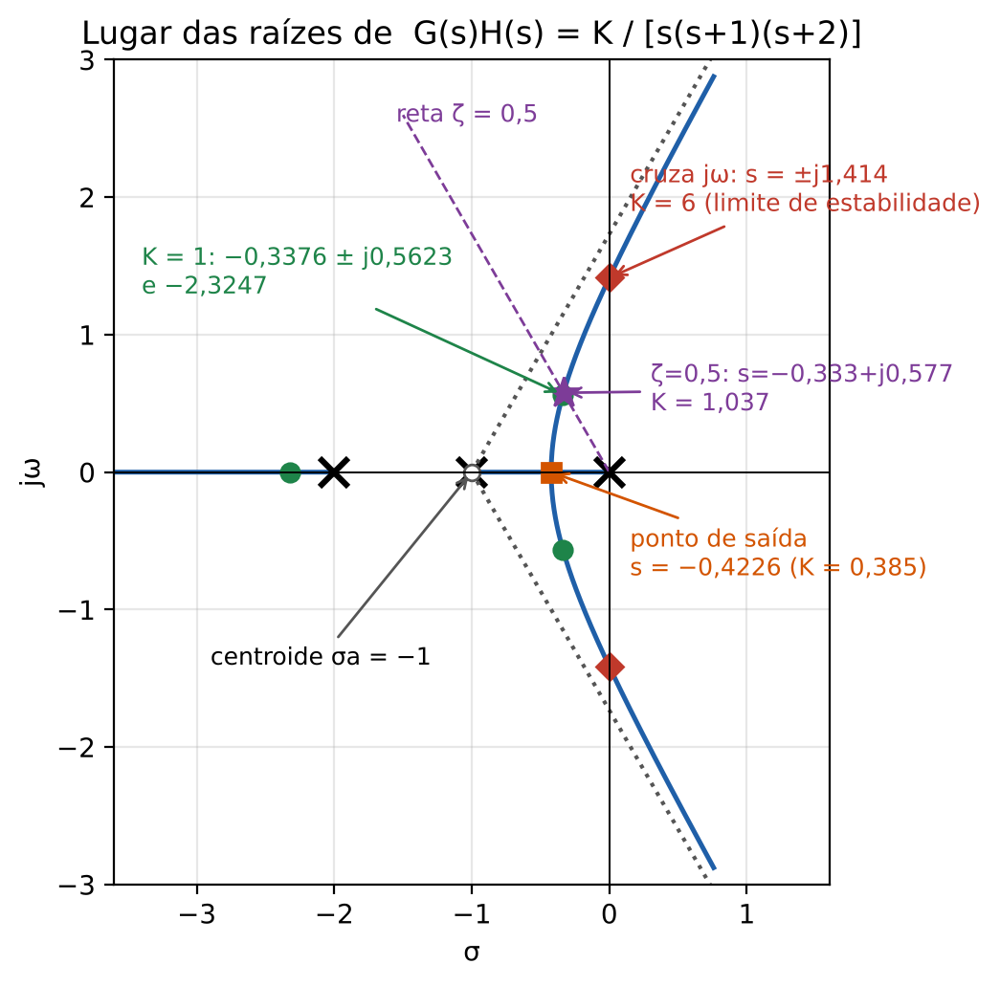

# Teoria de Controle – guia de estudo

Material de estudo de Teoria de Controle (Engenharia de Controle e Automação, UFOP), montado a partir das aulas, dos slides e das listas resolvidas no caderno. Todas as contas foram conferidas numericamente.

**Site interativo:** https://tolonio.github.io/teoria-de-controle/ (ou abra `docs/index.html` no navegador)



## O que tem aqui

| Arquivo / pasta | O que é |
|---|---|
| [`Teoria_de_Controle_Guia_de_Estudo.pdf`](Teoria_de_Controle_Guia_de_Estudo.pdf) | Guia para imprimir (72 páginas), começando direto pelo mapa da matéria. No topo de cada página há uma linha "Revise antes" com as páginas onde estão os conceitos que ela usa. |
| [`docs/index.html`](docs/index.html) | Site interativo: cada conceito vira botões e curvas ao vivo, mais o simulador de lugar das raízes passo a passo. |
| [`figuras/`](figuras) | Todas as figuras do guia em PNG (lista abaixo). |
| [`src/`](src) | Scripts Python que fazem as contas, geram as figuras e montam o PDF. |

## Conteúdo do PDF (em ordem lógica)

| Pág. | Capítulo | O que explica |
|---:|---|---|
| 1 | 0. Como encarar a matéria | O mapa da disciplina e a tabela de siglas e símbolos |
| 3 | A. Malha aberta e malha fechada | Controle "cego" × com sensor, exemplos do dia a dia, papel de cada bloco, exemplo real do Rashid (regulação de 10,55% → 1,16%), realimentação negativa × positiva |
| 7 | B. Impedância | Z = V/I, resistor, capacitor (1/sC) e indutor (sL), frequência e defasagem, série/paralelo/divisor, filtros RC |
| 9 | C. Amplificador operacional | Regras de ouro, −Zf/Zi, inversor, não inversor, diferencial (= controlador P), I, D, PI, PD, avanço/atraso |
| 11 | 1. Laplace, FT e diagramas de blocos | O que é o s, transformada de Laplace, EDO em 4 passos, impulso e convolução, exemplos físicos, FTMA/FTMF, Mason, sensibilidade |
| 17 | 2. Polos, zeros e resposta transitória | Plano s, glossário, especificações (td, tr, tp, Mp, ts), 1ª ordem, 2ª ordem (classificação por ζ e fórmulas), ordem superior, polos dominantes, efeito de polos e zeros extras |
| 24 | 3. Estabilidade e instabilidade | Estável/marginal/instável, por que é a parte real, onde e por que fica instável, Routh-Hurwitz |
| 26 | 4. Erro em regime | Tipo do sistema, Kp, Kv, Ka |
| 28 | 5. Lugar das raízes | LGR básico com polos e zeros, regras da apostila, exemplo completo |
| 32 | 6. Como achar o K | Condição de módulo, Routh, erro, ponto de saída |
| 33 | 7. Controladores | PD (slide), família completa, PID com exemplos de P, I e D, on-off, alocação de zeros, Ziegler-Nichols (os dois métodos) |
| 41 | 8. Avanço e atraso de fase | Origem no capacitor, rede RC, deficiência angular, atraso da aula |
| 47 | 9. Parte de Acionamentos Elétricos | Baseada só no cap. 14 (Acionamentos CC) do Rashid: motor CC, motor série e linearização, conversor como atuador, FT em malha aberta e fechada, Ex. 14.1, 14.8, 14.13 e 14.14 conferidos, cascata corrente/velocidade, ótimo simétrico, mapa conceito × livro |
| 52 | 10. Bode e Nyquist | O que o Bode representa fisicamente e como ler, Nyquist (Z = N + P), margens |
| 55 | 11. Espaço de estados | Polos = autovalores, alocação de polos, controlabilidade, observador |
| 57 | 12. Controle digital e transformada Z | Círculo unitário, ZOH, PID no Arduino |
| 59 | 13. Exercícios resolvidos | Com o quadro "Polos e zeros nesta questão" |
| 71 | 14. Exercícios propostos | Com gabarito |
| 72 | 15. Formulário e MATLAB | Fórmulas de bolso |

## Site interativo (`docs/index.html`)

- **Polos:** arraste o polo no plano s e veja a resposta ao degrau mudar.
- **2ª ordem e 1ª ordem:** controles de ζ, ωn, τ e K.
- **Ganho K:** polos de malha fechada andando sobre o lugar das raízes, com resposta e estabilidade.
- **Erro em regime:** tipo 0, 1 e 2 contra degrau, rampa e parábola.
- **PID:** controles de Kp, Ki e Kd com as parcelas P, I e D desenhadas e a verificação de Routh.
- **On-off:** aquecedor com histerese e atraso, animado.
- **Amp-op:** circuitos com as ondas de entrada e saída.
- **Avanço/atraso:** ângulo no polo desejado e diagrama de fase.
- **Simulador de lugar das raízes passo a passo:** os 7 passos da apostila. Clique no plano para ver ∠G, K e ζ do ponto, com a tabela de Routh do K atual.

## Figuras (`figuras/`)

| Figura | Mostra |
|---|---|
| `malha_ab_fe.png`, `malha_sim.png` | Malha aberta × fechada: diagramas e o motor com carga e desgaste |
| `impedancia.png` | Impedância de R, L e C × frequência e como número complexo |
| `realim_positiva.png` | Realimentação positiva × negativa |
| `resp_transitoria.png`, `ordem_superior.png` | Especificações da resposta transitória e efeito de polos/zeros extras |
| `bode_motor.png`, `bode_fisico.png` | Bode do motor do Ex. 14.14 e o significado físico (senoides) |
| `rashid_regulacao.png`, `rashid_velocidade.png` | Ex. 14.13 (regulação) e malha de velocidade do Ex. 14.14 (43,4% → 8,1%) |
| `zn.png` | Sintonia de Ziegler-Nichols na planta da aula e no motor |
| `ampop.png` | Amp-op ideal e circuitos de controle (inversor, não inversor, diferencial, PI, avanço/atraso) |
| `malha.png`, `pid.png` | Diagramas de malha fechada e do PID |
| `primeira_ordem.png`, `massa_mola.png` | Resposta de 1ª ordem e o sistema massa-mola-amortecedor |
| `plano_s.png`, `geometria.png`, `degrau_zeta.png` | Polo × forma da resposta, geometria de ζ e ωn, efeito de ζ |
| `maquina_zero.png` | Polo de malha fechada atravessando para a direita (zero em +2) |
| `estab_mapas.png` | Regiões de estabilidade nos planos s e z |
| `regra_eixo.png`, `lgr_basico.png`, `lgr_principal.png` | Regra do eixo real, seis LGRs básicos, LGR completo da aula |
| `lgr_A.png` a `lgr_D.png` | LGRs dos exercícios das listas |
| `pd_zero.png`, `pid_comp.png`, `ex_pid_E.png`, `ex_pid_F.png` | Efeito do zero do PD, comparação P/PI/PD/PID, respostas dos PIDs projetados |
| `onoff.png` | Relé com histerese e oscilação do aquecedor |
| `capacitor.png`, `rede_avanco.png`, `rede_atraso.png`, `fase_avanco.png` | Origem elétrica do avanço de fase e as redes RC |
| `avanco_exemplo.png`, `atraso_exemplo.png` | Projetos de avanço e de atraso (antes × depois) |
| `motor_blocos.png`, `motor_resp.png` | Diagrama de blocos do motor CC e controle P × PI |
| `nyquist.png`, `bode_margens.png` | Critério de Nyquist e margens de ganho e de fase |
| `ss_resp.png` | Alocação de polos por realimentação de estados |
| `z_discreto.png` | Malha fechada digital e limite de K pela amostragem |

## Como regenerar

Precisa de Python 3 com numpy, scipy, matplotlib e reportlab, e das fontes DejaVu.

```bash
cd src
python3 figs.py && python3 figs2.py && python3 figs3.py && python3 figs4.py && python3 figs5.py && python3 figs6.py   # figuras
python3 assemble.py && python3 build2.py                                      # PDF (duas passagens para numerar páginas)
```

`calc*.py` são as conferências numéricas dos exemplos (polos, K, compensadores e os exemplos do Rashid em `calc5.py`).

A parte de Acionamentos (cap. 9) usa como única base o Capítulo 14 – Acionamentos CC de Rashid, *Eletrônica de Potência*; o livro não está incluído neste repositório.
